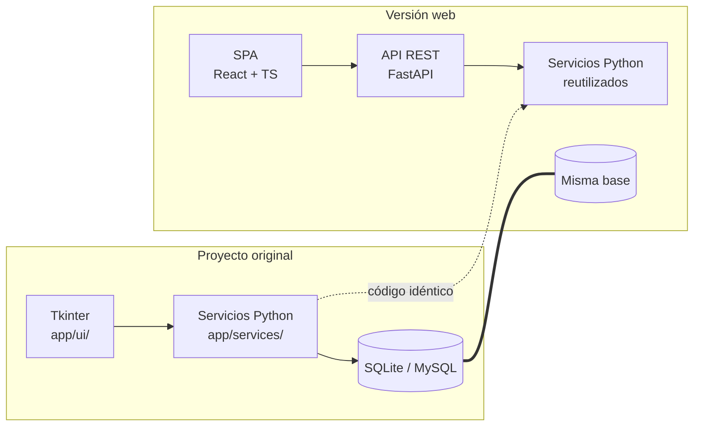

# 00 — Resumen ejecutivo

## 1. Qué es Parkium

Parkium es un **sistema de administración de parqueaderos para escritorio de
Windows**. Registra la entrada y la salida de vehículos, cobra por tarifa
según el tiempo de permanencia, emite comprobantes imprimibles, administra
mensualidades y convenios, controla la caja por turno y audita todo lo que
ocurre.

**Público objetivo:** el operador del mostrador (cobra), el administrador
(gestiona tarifas, usuarios y caja) y el super administrador (datos fiscales,
plantillas, reportes y exportación). No es un producto de consumo ni una app
móvil: es una herramienta de un único local, que puede tener varias sedes.

> Fuente: `README.md`, `docs/arquitectura-y-alcance.md`, `prompt-software-parqueadero.md`.

## 2. Plataforma actual

| Aspecto | Detalle | Fuente |
|---|---|---|
| SO | Windows 10/11 | `parkium.spec`, `pyproject.toml` |
| Lenguaje | Python ≥ 3.11 | `pyproject.toml` |
| Interfaz | Tkinter + Pillow (sin frameworks web) | `app/ui/` |
| Base de datos | SQLite en desarrollo; **MySQL 8 previsto para producción** | `app/data/temporary_database.py`, `sql/001_initial_schema.sql` |
| ORM | SQLAlchemy 2.x **en paralelo**; la lógica usa `sqlite3` crudo | `app/data/models.py`, `app/data/temporary_database.py` |
| Empaquetado | PyInstaller + instalador Inno Setup | `parkium.spec`, `installer/parkium.iss` |
| Impresión | ESC/POS por spooler de Windows (pywin32) | `app/services/printing.py` |

> **Dato clave:** la lógica de negocio usa `sqlite3` directamente, mientras
> `app/data/models.py` mantiene el mapeo ORM y `sql/*.sql` el esquema MySQL de
> producción. La versión web **debe decidir** cuál de las dos rutas es la fuente
> de verdad (ver [12-preguntas-abiertas.md](12-preguntas-abiertas.md) §1).

## 3. El problema que resuelve la versión web

La aplicación de escritorio tiene tres limitaciones que la web elimina:

1. **Un solo puesto de trabajo.** Hoy el operador debe ir a la caja. Con la web
   se puede cobrar desde el celular o desde otra terminal.
2. **Sin acceso desde otro equipo.** Los reportes, el histórico y la
   configuración exigen el equipo donde está instalada.
3. **Sin acceso desde otros navegadores ni desde el móvil.** La pantalla está
   diseñada para 1320×820 con barra lateral fija.

Lo que **no** mejora con la web —y hay que preservar tal cual— es la
**integridad de los cobros**: el bloqueo por manipulación del reloj, el cálculo
transaccional de la tarifa y la idempotencia de los pagos.

## 4. Decisión de arquitectura principal

**Reutilizar la base de datos y la lógica de negocio; sustituir sólo la capa de
presentación.**

El proyecto tiene ~450 KB de lógica de negocio verificada por 92 pruebas
unitarias y 41 pruebas de arnés. Reescribirla en JavaScript introduciría
regresiones en cobros reales. La estrategia es:

La recomendación completa está en
[05-modulos-implementacion.md](05-modulos-implementacion.md) y los
justificativos en [02-estructura-carpetas.md](02-estructura-carpetas.md).

## 5. Lo que hay que construir

Siete áreas funcionales, todas con paridad completa:

| Área | Qué incluye |
|---|---|
| **Autenticación** | Login, recuperación local, primera ejecución, sesiones de 12 h, cambio de contraseña |
| **Operación** | Ingreso con factura, cotización de salida, cobro con cambio y vuelto, reimpresión |
| **Histórico** | Búsqueda por placa/fechas/estado, ocupación por hora, detalle por hora |
| **Mensualidades** | Clientes, placas, planes, saldos, renovación, cobro, cancelación |
| **Configuración** | 6 pestañas: tarifas, usuarios, caja, seguridad, parqueadero, plantilla |
| **Reportes** | Resumen, exportaciones CSV/JSON/XLSX/PDF, XLSX con gráficos |
| **Impresión** | Comprobantes ESC/POS, vista previa, PDF, PNG térmico, QR, Code128 |

## 6. Funcionalidades que dependen de la plataforma

| Dependencia | Equivalente web | Nota |
|---|---|---|
| Spooler de Windows (ESC/POS) | **Impresión desde el navegador** + servidor con `pywin32` | Ver [01](01-matriz-paridad-funcional.md) §1.3 |
| `time.monotonic()` para el reloj | **Ancla horaria en servidor** | Crítico: ver [05](05-modulos-implementacion.md) §7 |
| Archivo SQLite local | PostgreSQL/MySQL en servidor | — |
| `runtime/` en disco | Almacenamiento de objetos o BD | — |
| Tkinter `Canvas` para el gráfico | Chart.js o Recharts | — |
| Pilow/PyInstaller | Build web (Vite) + CDN o assets propios | — |

**El punto más delicado es el reloj.** La verificación de integridad del reloj
usa un reloj monotónico del proceso, que **no existe en el navegador**. Ver
[05-modulos-implementacion.md](05-modulos-implementacion.md) §7 para el diseño
equivalente, que es el riesgo técnico número uno de este proyecto.

## 7. Cómo usar este conjunto de documentos

1. Leer [00](00-resumen-ejecutivo.md) y [01](01-matriz-paridad-funcional.md).
2. Resolver [12-preguntas-abiertas.md](12-preguntas-abiertas.md) **antes** de
   escribir código.
3. Implementar siguiendo el orden de [09-plan-implementacion.md](09-plan-implementacion.md).
4. Verificar con [11-checklist-verificacion.md](11-checklist-verificacion.md).

Cada módulo de [05](05-modulos-implementacion.md) incluye criterios de
aceptación verificables y las pruebas requeridas.