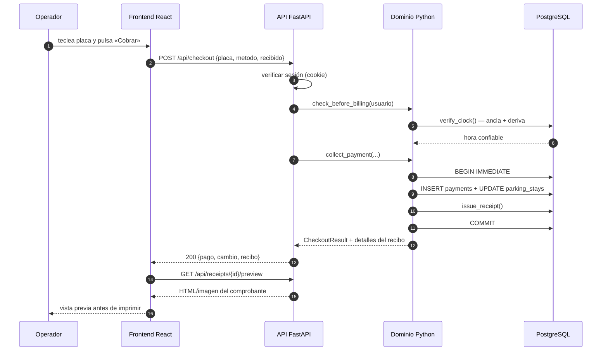

# 02 — Estructura de carpetas

## 2.1 Decisión de stack y su justificación

### Principio rector: **no duplicar la lógica de negocio**

El proyecto original tiene ~450 KB de Python de dominio, verificado por 92
pruebas unitarias y 41 de arnés. Los cobros manejan dinero real: una
regresión en `collect_payment` no es un error de interfaz, es un error
contable. Por eso la recomendación es:

| Capa | Elección | Por qué |
|---|---|---|
| **Base de datos** | **La misma**: PostgreSQL (recomendado) o MySQL 8 | El original ya tiene `sql/001_initial_schema.sql` para MySQL 8. Cambiar de motor sería una migración sin beneficio. |
| **Lógica de negocio** | **Python, reutilizada** | `app/services/` funciona casi sin cambios: usa `sqlite3` estándar y `Decimal`. |
| **API** | **FastAPI** (Python) | Llamada a las funciones Python **en el mismo proceso**: sin RPC, sin duplicar reglas. |
| **Interfaz** | **React + TypeScript + Vite** | Equipo mantenido, tipos fuertes para contratos, `vite-plugin-pwa` para instalable. |
| **Autenticación web** | Cookie de sesión + tabla `user_sessions` | Reutiliza `authenticate` / `validate_session` sin cambios. |

> **Alternativa considerada y descartada:** reescribir todo en Node/TypeScript.
> Exige portar ~450 KB de reglas de cobros verificadas y descartar las 92
> pruebas. El ahorro no compensa el riesgo en dinero real.

### Sobre SQLite → PostgreSQL

El código de `app/services/` usa `sqlite3` estándar **y** funciones
específicas:

| Función | Archivo | Problema en PostgreSQL |
|---|---|---|
| `julianday(fecha)` | `history.py:search_history`, `occupancy_by_hour` | No existe |
| `INSERT OR IGNORE` | `temporary_database.py:SEED_DATA` | Se usa `ON CONFLICT DO NOTHING` |
| `last_insert_rowid()` | `temporary_database.py` | `cursor.lastrowid` de `psycopg` sí existe |
| `PRAGMA` | `database.py`, `temporary_database.py` | No aplica |
| `row_factory = sqlite3.Row` | Todos los servicios | Reemplazar por acceso por índice |

El punto crítico son **`julianday()`**. Aparece en el filtro de fechas del
histórico y en el cálculo de ocupación por hora. Debe reescribirse a
comparación de `TIMESTAMPTZ` directo. Ver
[05-modulos-implementacion.md](05-modulos-implementacion.md) §3.

### Estructura propuesta

```
Parkium Web/
├── README.md
├── 00-resumen-ejecutivo.md
├── 01-matriz-paridad-funcional.md
├── 02-estructura-carpetas.md              ← este archivo
├── 03-esquema-base-datos.md
├── 04-especificacion-api.md
├── 05-modulos-implementacion.md
├── 06-sistema-diseno.md
├── 07-autenticacion-autorizacion.md
├── 08-configuracion-despliegue.md
├── 09-plan-implementacion.md
├── 10-migracion-y-convivencia.md
├── 11-checklist-verificacion.md
├── 12-preguntas-abiertas.md
├── 13-auditoria-completitud.md
│
├── backend/                                ← API + lógica de negocio
│   ├── pyproject.toml
│   ├── alembic.ini
│   ├── migrations/                         ← Alembic (versiones del esquema)
│   │   ├── env.py
│   │   └── versions/
│   ├── app/
│   │   ├── main.py                         ← FastAPI, CORS, estáticos
│   │   ├── config.py                       ← pydantic-settings (COPIA de app/config.py)
│   │   ├── db.py                           ← engine, sesión, dependency get_db
│   │   ├── deps.py                         ← get_current_user, require_role, require_superadmin
│   │   ├── schemas/                        ← Pydantic (contratos de entrada/salida)
│   │   │   ├── common.py
│   │   │   ├── auth.py
│   │   │   ├── parking.py
│   │   │   ├── history.py
│   │   │   ├── subscriptions.py
│   │   │   ├── cash.py
│   │   │   ├── reports.py
│   │   │   └── site.py
│   │   ├── api/                            ← routers, UNO POR MÓDULO
│   │   │   ├── __init__.py
│   │   │   ├── auth.py
│   │   │   ├── parking.py
│   │   │   ├── history.py
│   │   │   ├── subscriptions.py
│   │   │   ├── cash.py
│   │   │   ├── reports.py
│   │   │   ├── admin.py                   ← tarifas, usuarios, sitio, plantilla
│   │   │   └── health.py
│   │   └── domain/                         ← COPIA ADAPTADA de app/services/
│   │       ├── __init__.py
│   │       ├── authentication.py           ← reutilizado
│   │       ├── parking_operations.py       ← reutilizado, julianday() sustituido
│   │       ├── subscriptions.py           ← reutilizado
│   │       ├── history.py                 ← reutilizado, julianday() sustituido
│   │       ├── receipts.py                ← reutilizado
│   │       ├── cash.py                    ← reutilizado
│   │       ├── site_settings.py           ← reutilizado
│   │       ├── time_integrity.py          ← ADAPTADO (reloj del servidor)
│   │       ├── time_utils.py              ← reutilizado
│   │       ├── reports.py                 ← reutilizado
│   │       └── exporters.py               ← reutilizado
│   └── tests/
│       ├── conftest.py                    ← base de pruebas con datos
│       ├── test_auth.py
│       ├── test_parking.py
│       ├── test_history.py
│       ├── test_subscriptions.py
│       ├── test_cash.py
│       └── test_reports.py
│
├── frontend/                               ← SPA React
│   ├── package.json
│   ├── vite.config.ts
│   ├── tsconfig.json
│   ├── index.html
│   ├── public/
│   │   ├── manifest.webmanifest
│   │   └── icons/
│   └── src/
│       ├── main.tsx
│       ├── App.tsx
│       ├── api/                           ← cliente HTTP tipado
│       │   ├── client.ts
│       │   ├── auth.ts
│       │   ├── parking.ts
│       │   ├── history.ts
│       │   ├── subscriptions.ts
│       │   ├── cash.ts
│       │   ├── reports.ts
│       │   └── admin.ts
│       ├── theme/                         ← paleta y modo claro/oscuro
│       │   ├── palette.ts
│       │   ├── ThemeProvider.tsx
│       │   └── global.css
│       ├── components/                    ← reutilizables
│       │   ├── ui/                        ← Button, Input, Select, Table, Modal…
│       │   ├── layout/                    ← Shell, Sidebar, Topbar, Page
│       │   ├── charts/                    ← OccupancyChart
│       │   └── DatePicker/                ← calendario emergente
│       ├── pages/
│       │   ├── LoginPage.tsx
│       │   ├── RecoveryPage.tsx
│       │   ├── DashboardPage.tsx
│       │   ├── OperationsPage.tsx
│       │   ├── HistoryPage.tsx
│       │   ├── SubscriptionsPage.tsx
│       │   ├── ReportsPage.tsx
│       │   ├── SettingsPage.tsx           ← 6 pestañas
│       │   └── NotFoundPage.tsx
│       ├── hooks/
│       ├── routes.tsx
│       └── types/                         ← tipos generados del contrato
│
├── assets/                                ← recursos de marca
│   ├── IMG/                               ← originales (IconParkium.png, Login_Image.png, pakium.png)
│   └── generated/                         ← logo.png, icon_app.png, login_bg.jpg
│
├── deploy/
│   ├── docker-compose.yml                 ← postgres + api + web
│   ├── Dockerfile.api
│   ├── Dockerfile.web
│   ├── nginx.conf
│   └── .env.production.example
│
└── scripts/
    ├── create_first_admin.py
    ├── backup.sh
    └── restore.sh
```

## 2.2 Qué se copia y qué se reescribe

| Archivo original | Destino | Acción |
|---|---|---|
| `app/services/authentication.py` | `backend/app/domain/authentication.py` | **Copiar.** Solo cambiar la conexión. |
| `app/services/parking_operations.py` | `backend/app/domain/parking_operations.py` | **Copiar** y sustituir `julianday()`. |
| `app/services/subscriptions.py` | `backend/app/domain/subscriptions.py` | **Copiar.** |
| `app/services/history.py` | `backend/app/domain/history.py` | **Copiar** y sustituir `julianday()`. |
| `app/services/receipts.py` | `backend/app/domain/receipts.py` | **Copiar.** |
| `app/services/cash.py` | `backend/app/domain/cash.py` | **Copiar.** |
| `app/services/site_settings.py` | `backend/app/domain/site_settings.py` | **Copiar.** |
| `app/services/time_utils.py` | `backend/app/domain/time_utils.py` | **Copiar.** |
| `app/services/reports.py` | `backend/app/domain/reports.py` | **Copiar.** |
| `app/services/exporters.py` | `backend/app/domain/exporters.py` | **Copiar.** |
| `app/services/time_integrity.py` | `backend/app/domain/time_integrity.py` | **Adaptar** (§7 de módulo 05). |
| `app/services/printing.py` | `backend/app/domain/printing.py` | **Adaptar**: sin `pywin32` en Linux. |
| `app/services/maintenance.py` | `scripts/` | **Reescribir**: respaldos de PostgreSQL. |
| `app/services/receipt_web.py` | — | **Eliminar**: la ruta web lo reemplaza. |
| `app/services/electronic_invoicing.py` | `backend/app/domain/electronic_invoicing.py` | **Copiar** (queda `DISABLED`). |
| `app/data/temporary_database.py` | `backend/migrations/` | **Reescribir** con Alembic. |
| `sql/001_initial_schema.sql` | `backend/migrations/versions/0001` | **Punto de partida** del esquema MySQL. |
| `app/ui/*` | `frontend/src/*` | **Reescribir** en React. |
| `app/config.py` | `backend/app/config.py` | **Reescribir** con pydantic-settings. |
| `app/logging_config.py` | `backend/app/main.py` | **Reescribir** con logging estándar. |

## 2.3 Flujo de datos



## 2.4 Estrategia de estado en el frontend

| Dato | Dónde vive | Por qué |
|---|---|---|
| Usuario y rol | `AuthContext` (memoria + `localStorage` no sensible) | Condiciona navegación y permisos de UI |
| Tema claro/oscuro | `ThemeProvider` + `localStorage` | Replica `runtime/tema.json` |
| Listados (histórico, clientes) | `TanStack Query` | Caché, recarga y paginación sin código extra |
| Formularios de cobro | `useState` local | Deben ser efímeros: nunca guardar un importe |
| Turno de caja abierto | `CashShiftContext` | Se consulta al cobrar; afecta a todos los cobros |

> **Regla de seguridad heredada:** el frontend **oculta** botones por rol, pero
> la autorización real está en la API. Es la misma política del original
> (`app/services/authentication.require_role`). Nunca se confiar en el cliente.

## 2.5 Rutas y SEO

Es una aplicación interna autenticada: **no hay SEO que optimizar**. Lo que sí
importa:

| Ruta | Vista | Acceso |
|---|---|---|
| `/login` | LoginPage | Público |
| `/recuperar` | RecoveryPage | Público (ver §2 de preguntas abiertas) |
| `/` | DashboardPage | Autenticado |
| `/operacion` | OperationsPage | Autenticado |
| `/historico` | HistoryPage | Autenticado |
| `/mensualidades` | SubscriptionsPage | Admin |
| `/reportes` | ReportsPage | Super admin |
| `/configuracion` | SettingsPage | Admin (pestañas por rol) |
| `/r/:token` | Recibo público (fuera de la SPA) | Público, por token |
| `/ocupacion/:dia/:hora` | Detalle de ocupación | Autenticado |

## 2.6 Responsive

| Ancho | Comportamiento | Fuente del dato |
|---|---|---|
| ≥ 1440 px | Sidebar 235 px fijo + contenido | `main_window.py:nav.place(x=0, y=110, width=235, height=420)` |
| 1080–1439 px | Sidebar colapsable a iconos | Original mínimo `minsize(1080, 680)` |
| 768–1079 px | Sidebar en cajón, tablas con scroll horizontal | — |
| < 768 px | Navegación inferior, tablas en tarjetas | — |

En móvil, las pantallas de **Operación** y **Mensualidades** son las críticas:
el cobrador necesita teclear placas e importes con el pulgar. Los formularios de
alta de mensualidad se reorganizan en una columna.