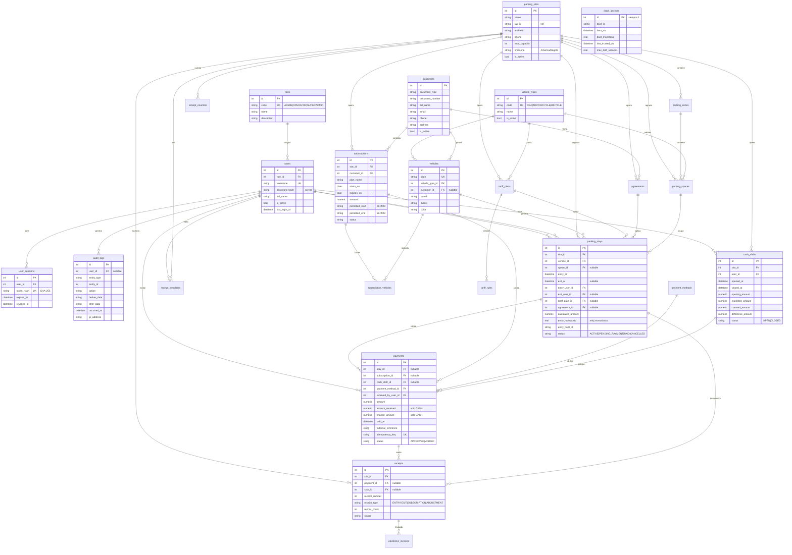

# 03 — Esquema de base de datos

**Verificado contra `app/data/temporary_database.py` (SCHEMA_VERSION 3) y `sql/001_initial_schema.sql`.**

- **Motor de desarrollo:** SQLite, `journal_mode=delete`, integridad referencial
  activa.
- **Motor de producción previsto:** MySQL 8 (`sql/001_initial_schema.sql`).
- **Motor recomendado para la web:** **PostgreSQL 15+** (ver §3.9).
- **25 tablas, 0 vistas, 0 triggers, 19 índices explícitos.**

---

## 3.1 Diagrama entidad-relación



---

## 3.2 Tablas del sistema de acceso

### `roles`

| Columna | Tipo | Restricciones |
|---|---|---|
| `id` | INTEGER | PK |
| `code` | TEXT | **UNIQUE**, NOT NULL |
| `name` | TEXT | NOT NULL |
| `description` | TEXT | |
| `created_at` | TEXT | NOT NULL, DEFAULT CURRENT_TIMESTAMP |

Índice: `sqlite_autoindex_roles_1` UNIQUE(`code`).

### `users`

| Columna | Tipo | Restricciones |
|---|---|---|
| `id` | INTEGER | PK |
| `role_id` | INTEGER | NOT NULL, FK→`roles.id` NO ACTION |
| `username` | TEXT | **UNIQUE**, NOT NULL |
| `password_hash` | TEXT | NOT NULL — formato `scrypt$N$r$p$salt$hash` |
| `full_name` | TEXT | NOT NULL |
| `is_active` | INTEGER | NOT NULL, DEFAULT 1 |
| `created_at` / `updated_at` | TEXT | NOT NULL, DEFAULT CURRENT_TIMESTAMP |
| `last_login_at` | TEXT | |

Índice: `sqlite_autoindex_users_1` UNIQUE(`username`).
Formato de usuario: `^[A-Za-z0-9._-]{3,60}$` (`_USERNAME_PATTERN`).

### `user_sessions`

| Columna | Tipo | Restricciones |
|---|---|---|
| `id` | INTEGER | PK |
| `user_id` | INTEGER | NOT NULL, FK→`users.id` **CASCADE** |
| `token_hash` | TEXT | **UNIQUE**, NOT NULL — SHA-256, nunca el token en claro |
| `created_at` | TEXT | NOT NULL, DEFAULT CURRENT_TIMESTAMP |
| `expires_at` | TEXT | NOT NULL — `created_at + 12 h` (`SESSION_DURATION`) |
| `revoked_at` | TEXT | |

Índices: UNIQUE(`token_hash`), `ix_sessions_active(token_hash, expires_at, revoked_at)`.

---

## 3.3 Tablas maestras del parqueadero

### `parking_sites`

| Columna | Tipo | Restricciones |
|---|---|---|
| `id` | INTEGER | PK |
| `name` | TEXT | NOT NULL |
| `tax_id` | TEXT | — NIT |
| `address` | TEXT | |
| `phone` | TEXT | |
| `total_capacity` | INTEGER | NOT NULL, DEFAULT 0 |
| `timezone` | TEXT | NOT NULL, DEFAULT `'America/Bogota'` |
| `is_active` | INTEGER | NOT NULL, DEFAULT 1 |
| `created_at` | TEXT | NOT NULL, DEFAULT CURRENT_TIMESTAMP |

Índice: `ix_sites_active(is_active)`.
`DEFAULT_SITE_ID = 1`.

### `parking_zones`

| Columna | Tipo | Restricciones |
|---|---|---|
| `id` | INTEGER | PK |
| `site_id` | INTEGER | NOT NULL, FK→`parking_sites.id` **CASCADE** |
| `name` | TEXT | NOT NULL |
| `is_active` | INTEGER | NOT NULL, DEFAULT 1 |
| `created_at` | TEXT | NOT NULL, DEFAULT CURRENT_TIMESTAMP |

Índice: **UNIQUE(`site_id`, `name`)**.

### `parking_spaces`

| Columna | Tipo | Restricciones |
|---|---|---|
| `id` | INTEGER | PK |
| `zone_id` | INTEGER | NOT NULL, FK→`parking_zones.id` **CASCADE** |
| `code` | TEXT | NOT NULL — código del cupo, p. ej. `A-01` |
| `vehicle_type_id` | INTEGER | NOT NULL, FK→`vehicle_types.id` — tipo admitido en el cupo |
| `is_active` | INTEGER | NOT NULL, DEFAULT 1 |

Índice: **UNIQUE(`zone_id`, `code`)**.

> **Ambas tablas se crean pero la interfaz actual no las usa.** El operador
> registra una placa, no un cupo: la ocupación se cuenta como estadías activas y
> `parking_stays.space_id` queda nulo. Se conservan sin variantes para mantener
> la fidelidad del esquema y no reabrir la decisión si algún día se asignan
> cupos. Ver [12-preguntas-abiertas.md](12-preguntas-abiertas.md) §9.

### `vehicle_types`

| `id` | `code` UNIQUE | `name` | `is_active` | `created_at` |
|---|---|---|---|---|

Catálogo: `CAR`/Carro (1), `MOTORCYCLE`/Moto (2), `BICYCLE`/Bicicleta (3).

### `vehicles`

| Columna | Tipo | Restricciones |
|---|---|---|
| `id` | INTEGER | PK |
| `plate` | TEXT | **UNIQUE**, NOT NULL — normalizada a mayúsculas sin espacios |
| `vehicle_type_id` | INTEGER | NOT NULL, FK→`vehicle_types.id` |
| `customer_id` | INTEGER | FK→`customers.id`, **nullable** (vehículo sin cliente) |
| `brand`, `model`, `color`, `notes` | TEXT | |
| `created_at` | TEXT | NOT NULL, DEFAULT CURRENT_TIMESTAMP |

Índices: UNIQUE(`plate`), `ix_vehicles_plate(plate)`.

### `customers`

| Columna | Tipo | Restricciones |
|---|---|---|
| `id` | INTEGER | PK |
| `document_type` | TEXT | |
| `document_number` | TEXT | |
| `full_name` | TEXT | NOT NULL |
| `email`, `phone`, `address` | TEXT | |
| `is_active` | INTEGER | NOT NULL, DEFAULT 1 |
| `created_at` | TEXT | NOT NULL, DEFAULT CURRENT_TIMESTAMP |

Índice: `uq_customers_document` **UNIQUE(`document_type`, `document_number`)**.
El documento no se repite: dos fichas para la misma persona acabarían en dos
saldos que nadie reconcilia (`create_customer`).

---

## 3.4 Tablas de operación

### `tariff_plans`

| Columna | Tipo | Restricciones |
|---|---|---|
| `id` | INTEGER | PK |
| `site_id` | INTEGER | NOT NULL, FK→`parking_sites.id` |
| `vehicle_type_id` | INTEGER | NOT NULL, FK→`vehicle_types.id` |
| `name` | TEXT | NOT NULL |
| `billing_scheme` | TEXT | NOT NULL — uno de los 7 esquemas |
| `valid_from` | TEXT | NOT NULL — desde cuándo aplica |
| `valid_until` | TEXT | — hasta cuándo; `NULL` = vigente |
| `is_active` | INTEGER | NOT NULL, DEFAULT 1 |
| `created_by_user_id` | INTEGER | FK→`users.id` |
| `created_at` | TEXT | NOT NULL, DEFAULT CURRENT_TIMESTAMP |

Índice: `ix_tariff_lookup(site_id, vehicle_type_id, valid_from, valid_until)`.

Esquemas (`BILLING_SCHEMES`): `MINUTE`, `HOUR`, `HOUR_FRACTION`, `FLAT_ENTRY`,
`BLOCKS`, `DAY`, `NIGHT`.

> Las tarifas se **versionan**: una tarifa anterior no se edita, se crea una
> nueva con su vigencia (`docs/manual-usuario.md`). Por eso `valid_from` y
> `valid_until` son parte de la clave de búsqueda y no un adorno.

### `tariff_rules`

Tramos de cobro dentro de un plan. Un plan puede tener varios, ordenados por
`sequence_no`.

| Columna | Tipo | Restricciones |
|---|---|---|
| `id` | INTEGER | PK |
| `tariff_plan_id` | INTEGER | NOT NULL, FK→`tariff_plans.id` **CASCADE** |
| `sequence_no` | INTEGER | NOT NULL, DEFAULT 1 — orden del tramo |
| `start_minute` | INTEGER | NOT NULL, DEFAULT 0 — minuto en que empieza |
| `end_minute` | INTEGER | — minuto en que acaba; `NULL` = hasta el final |
| `amount` | NUMERIC | NOT NULL |
| `grace_minutes` | INTEGER | NOT NULL, DEFAULT 0 — minutos de gracia |
| `fraction_minutes` | INTEGER | — granularidad para redondear |

Índice: **UNIQUE(`tariff_plan_id`, `sequence_no`)**.

### `parking_stays`

| Columna | Tipo | Restricciones |
|---|---|---|
| `id` | INTEGER | PK |
| `site_id` | INTEGER | NOT NULL, FK→`parking_sites.id` |
| `vehicle_id` | INTEGER | NOT NULL, FK→`vehicles.id` |
| `space_id` | INTEGER | FK→`parking_spaces.id` |
| `entry_at` | TEXT | NOT NULL — ISO-8601 **UTC** |
| `exit_at` | TEXT | — ISO-8601 UTC |
| `entry_user_id` | INTEGER | NOT NULL, FK→`users.id` |
| `exit_user_id` | INTEGER | FK→`users.id` |
| `tariff_plan_id` | INTEGER | FK→`tariff_plans.id` |
| `agreement_id` | INTEGER | FK→`agreements.id` |
| `entry_photo_path`, `exit_photo_path` | TEXT | — **no usadas por la interfaz actual** |
| `calculated_amount` | NUMERIC | |
| `entry_monotonic` | REAL | — reloj monotónico al ingresar |
| `entry_boot_id` | TEXT | — identifica el proceso |
| `status` | TEXT | NOT NULL, DEFAULT `'ACTIVE'` |
| `notes` | TEXT | |
| `created_at` | TEXT | NOT NULL, DEFAULT CURRENT_TIMESTAMP |

Índices: `ix_stays_site_entry(site_id, entry_at)`,
`ix_stays_active_vehicle(vehicle_id, status)`,
`ix_stays_space_status(space_id, status)`.

Estados (`_ACTIVE_STATUSES`): `ACTIVE`, `PENDING_PAYMENT`, `PAID`, `CANCELLED`.

> **`entry_monotonic` + `entry_boot_id`** son la base de la seguridad de reloj:
> el cobro calcula el tiempo con el reloj monotónico si entrada y salida
> comparten proceso, y con la hora del sistema ya validada si no.
> Ver [05-modulos-implementacion.md](05-modulos-implementacion.md) §7.

### `payment_methods`

| `id` | `code` UNIQUE | `name` | `is_active` |
|---|---|---|---|

Catálogo: `CASH`/Efectivo (1), `CARD`/Tarjeta (2), `TRANSFER`/Transferencia (3),
`DIGITAL_WALLET`/Billetera digital (4).

### `payments`

| Columna | Tipo | Restricciones |
|---|---|---|
| `id` | INTEGER | PK |
| `stay_id` | INTEGER | FK→`parking_stays.id` — **XOR** con `subscription_id` |
| `subscription_id` | INTEGER | FK→`subscriptions.id` |
| `cash_shift_id` | INTEGER | FK→`cash_shifts.id` |
| `payment_method_id` | INTEGER | NOT NULL, FK→`payment_methods.id` |
| `received_by_user_id` | INTEGER | NOT NULL, FK→`users.id` |
| `amount` | NUMERIC | NOT NULL |
| `amount_received` | NUMERIC | — **sólo `CASH`** |
| `change_amount` | NUMERIC | — **sólo `CASH`** |
| `paid_at` | TEXT | NOT NULL, DEFAULT CURRENT_TIMESTAMP |
| `external_reference` | TEXT | — referencia bancaria |
| `idempotency_key` | TEXT | **UNIQUE** — protección contra doble cobro |
| `status` | TEXT | NOT NULL, DEFAULT `'APPROVED'` |
| `voided_by_user_id` | INTEGER | FK→`users.id` |
| `voided_at` | TEXT | |
| `void_reason` | TEXT | |

Índices: `ux_payments_idempotency` UNIQUE(`idempotency_key`),
`ix_payments_shift(cash_shift_id, status)`, `ix_payments_paid_at(paid_at)`.

> **Restricción que la web debe preservar:** un pago apunta a `stay_id` **o** a
> `subscription_id`, nunca a ambos (`app/data/models.py`, comentario de
> `Payment`). Es la garantía de que la caja no mezcla rotación con mensualidades.

### `cash_shifts`

| Columna | Restricciones |
|---|---|
| `id` | PK |
| `site_id` | NOT NULL, FK→`parking_sites.id` |
| `user_id` | NOT NULL, FK→`users.id` |
| `opened_at` | NOT NULL, DEFAULT CURRENT_TIMESTAMP |
| `closed_at` | |
| `opening_amount` | NOT NULL, DEFAULT 0 |
| `expected_amount`, `counted_amount`, `difference_amount` | |
| `status` | NOT NULL, DEFAULT `'OPEN'` |
| `notes` | |

Índices: `ux_cash_shift_open` **UNIQUE(`site_id`, `user_id`)** — un turno
abierto por usuario y sede; `ix_shifts_open(site_id, user_id, status)`.

---

## 3.5 Tablas de mensualidades y convenios

### `subscriptions`

| Columna | Restricciones |
|---|---|
| `id` | PK |
| `site_id` | NOT NULL, FK→`parking_sites.id` |
| `customer_id` | NOT NULL, FK→`customers.id` |
| `plan_name` | NOT NULL |
| `starts_on`, `expires_on` | NOT NULL — fechas civiles (`AAAA-MM-DD`) |
| `amount` | NOT NULL |
| `permitted_start`, `permitted_end` | — `HH:MM`, ambas o ninguna |
| `status` | NOT NULL, DEFAULT `'ACTIVE'` |
| `created_at` | NOT NULL, DEFAULT CURRENT_TIMESTAMP |

Índice: `ix_subscriptions_expiry(site_id, expires_on, status)`.

> **El estado guardado no se refresca solo.** `_effective_status` lo deriva de
> `expires_on` contra la fecha actual: un plan marcado `ACTIVE` que venció hace
> un mes se reporta `EXPIRED`. La web debe heredar esta regla o el listado
> mentirá.

### `subscription_vehicles`

| `subscription_id` PK | `vehicle_id` PK |
|---|---|

Clave compuesta, FK `subscription_id` → **CASCADE**, `vehicle_id` NO ACTION.

### `agreements`

| Columna | Restricciones |
|---|---|
| `id` | PK |
| `site_id` | NOT NULL, FK→`parking_sites.id` |
| `customer_id` | FK→`customers.id` |
| `name` | NOT NULL |
| `discount_type` | NOT NULL — porcentaje, fijo o tarifa especial |
| `discount_value` | NOT NULL, DEFAULT 0 |
| `valid_from` | NOT NULL |
| `valid_until` | |
| `is_active` | NOT NULL, DEFAULT 1 |
| `created_at` | NOT NULL, DEFAULT CURRENT_TIMESTAMP |

---

## 3.6 Tablas de comprobantes

### `receipts`

| Columna | Restricciones |
|---|---|
| `id` | PK |
| `site_id` | NOT NULL, FK→`parking_sites.id` |
| `payment_id` | FK→`payments.id` |
| `stay_id` | FK→`parking_stays.id` |
| `receipt_number` | NOT NULL — consecutivo **por sede** |
| `receipt_type` | NOT NULL — `ENTRY`, `EXIT`, `SUBSCRIPTION`, `ADJUSTMENT` |
| `issued_at` | NOT NULL, DEFAULT CURRENT_TIMESTAMP |
| `qr_payload` | |
| `reprint_count` | NOT NULL, DEFAULT 0 |
| `status` | NOT NULL, DEFAULT `'ISSUED'` |

Índice: UNIQUE(`site_id`, `receipt_number`).

### `receipt_counters`

| `site_id` PK (FK→`parking_sites.id` **CASCADE**) | `next_number` NOT NULL DEFAULT 1 |
|---|---|

### `receipt_templates`

| Columna | Restricciones |
|---|---|
| `id` | PK |
| `site_id` | NOT NULL, FK **CASCADE** |
| `template_name` | NOT NULL, DEFAULT `'Plantilla predeterminada'` |
| `parking_name` | NOT NULL, DEFAULT `'PARKIUM'` |
| `nit`, `address`, `header_text` | |
| `terms_text` | — `DEFAULT_TERMS_TEXT` (7 párrafos legales) |
| `footer_text` | — `DEFAULT_FOOTER_TEXT` = "PARKIUM - Todos los derechos reservados." |
| `show_barcode`, `show_qr` | NOT NULL, DEFAULT 1 |
| `is_active` | NOT NULL, DEFAULT 1 |
| `updated_by_user_id` | FK→`users.id` |
| `created_at`, `updated_at` | NOT NULL, DEFAULT CURRENT_TIMESTAMP |

Índices: UNIQUE(`site_id`, `template_name`), `ix_receipt_templates_site(site_id, is_active)`.

### `electronic_invoices`

| Columna | Restricciones |
|---|---|
| `id` | PK |
| `receipt_id` | NOT NULL, FK→`receipts.id` |
| `provider` | NOT NULL |
| `external_id`, `cufe`, `qr_payload` | |
| `status` | NOT NULL |
| `request_payload`, `response_payload`, `error_message` | |
| `created_at`, `updated_at` | NOT NULL, DEFAULT CURRENT_TIMESTAMP |

Índices: UNIQUE(`provider`, `receipt_id`), `ix_electronic_receipt(receipt_id)`.

> La tabla existe pero **el proveedor por defecto es `DisabledProvider`, que
> falla siempre** (`app/services/electronic_invoicing.py`). No se debe activar sin
> un Proveedor Tecnológico autorizado. Ver
> [12-preguntas-abiertas.md](12-preguntas-abiertas.md) §4.

---

## 3.7 Tablas de seguridad y auditoría

### `clock_anchors` — **una sola fila** (`id = 1`)

| Columna | Propósito |
|---|---|
| `boot_id` | Identificador del proceso (`current_boot_id`) |
| `boot_utc` | Hora del sistema al arrancar |
| `boot_monotonic` | `time.monotonic()` al arrancar |
| `last_trusted_utc` | Última hora considerada fiable — **sólo avanza si la verificación es limpia** |
| `max_drift_seconds` | Evidencia acumulada, **no veredicto de bloqueo** |

### `clock_checks`

| `id` PK | `checked_at` | `source` | `system_utc` | `reference_utc` | `drift_seconds` | `is_suspicious` | `message` |
|---|---|---|---|---|---|---|---|

Índice: `ix_clock_checks_occurred(checked_at)`.
Valores de `source`: `SISTEMA`, `RELOJ_MONOTONICO`, `FUENTE_EXTERNA`,
`FUENTE_EXTERNA_NO_DISPONIBLE`.

### `audit_logs`

| Columna | Restricciones |
|---|---|
| `id` | PK |
| `user_id` | FK→`users.id`, **nullable** (operaciones sin sesión) |
| `entity_type`, `entity_id` | Entidad afectada |
| `action` | NOT NULL — `CUSTOMER_CREATED`, `SUBSCRIPTION_PAYMENT`, `SUBSCRIPTION_RENEWED`, `SUBSCRIPTION_CANCELLED`, `VEHICLE_ATTACHED`… |
| `before_data`, `after_data` | TEXT — JSON |
| `occurred_at` | NOT NULL, DEFAULT CURRENT_TIMESTAMP |
| `ip_address` | TEXT — **sin uso actual**; en web es trivial de llenar y conviene hacerlo |

Índices: `ix_audit_occurred(occurred_at)`, `ix_audit_entity(entity_type, entity_id)`.

---

## 3.8 Datos iniciales (`SEED_DATA`)

Idempotente (`INSERT OR IGNORE` / `ON CONFLICT DO NOTHING`):

```sql
INSERT INTO roles (id, code, name, description) VALUES
  (1, 'ADMIN', 'Administrador',
      'Configuración operativa, usuarios y caja. Sin reportes ni datos fiscales.'),
  (2, 'OPERATOR', 'Operador',
      'Registra entradas, salidas, cobros y su caja.'),
  (3, 'SUPERADMIN', 'Super administrador',
      'Acceso total: datos del parqueadero, plantillas, reportes y usuarios.');

INSERT INTO vehicle_types (id, code, name) VALUES
  (1, 'CAR', 'Carro'), (2, 'MOTORCYCLE', 'Moto'), (3, 'BICYCLE', 'Bicicleta');

INSERT INTO payment_methods (id, code, name) VALUES
  (1, 'CASH', 'Efectivo'), (2, 'CARD', 'Tarjeta'),
  (3, 'TRANSFER', 'Transferencia'), (4, 'DIGITAL_WALLET', 'Billetera digital');

INSERT INTO parking_sites (id, name, total_capacity, timezone, is_active)
  VALUES (1, 'Parkium - Sede temporal', 30, 'America/Bogota', 1);

INSERT INTO receipt_counters (site_id, next_number) SELECT id, 1 FROM parking_sites WHERE id = 1;
```

> **Nota sobre roles:** el seed inserta `SUPERADMIN` con `id = 3`. La función
> `_migrate_existing_admin_to_superadmin` promueve el administrador heredado a
> super administrador sin crear una cuenta nueva, para que el operador conserve
> la contraseña que ya conoce. La web debe replicar esta migración.

## 3.9 Traducción del esquema a PostgreSQL

### 3.9.1 Tipos

| SQLite | PostgreSQL | Nota |
|---|---|---|
| `INTEGER` autoincremental | `SERIAL` / `GENERATED ALWAYS AS IDENTITY` | Preferir `IDENTITY` |
| `TEXT` | `TEXT` | Igual |
| `NUMERIC` | `NUMERIC(14,2)` | Importes: **nunca `float`** |
| `REAL` | `DOUBLE PRECISION` | Reloj monotónico y deriva |
| `INTEGER` (0/1) | `BOOLEAN` | `is_active`, `show_barcode`, `is_suspicious` |
| `created_at TEXT` | `TIMESTAMPTZ DEFAULT now()` | **Crítico**: ver §3.9.3 |

### 3.9.2 Reemplazos obligatorios

| SQLite | PostgreSQL | Dónde |
|---|---|---|
| `INSERT OR IGNORE` | `INSERT … ON CONFLICT DO NOTHING` | seeds |
| `julianday(fecha)` | `(fecha)::timestamptz` directo | `history.py:search_history`, `occupancy_by_hour` |
| `last_insert_rowid()` | `cursor.lastrowid` (psycopg lo da) | todos los servicios |
| `PRAGMA foreign_keys` | Siempre activo | `database.py` |
| `PRAGMA journal_mode=WAL` | Configuración del servidor | `database.py` |

### 3.9.3 Riesgo crítico: fechas como TEXT

Hoy `entry_at`, `exit_at`, `paid_at`, `issued_at` son `TEXT` con ISO-8601. Eso
**funciona** porque el formato se ordena lexicográficamente, pero impide:

- Restricciones `CHECK (exit_at > entry_at)`.
- Índices temporalmente confiables.
- Consultas de rango eficientes sin convertir en cada consulta.

**Recomendación:** en la web, migrar a `TIMESTAMPTZ`. Es la diferencia entre
una base que aguanta auditoría y una que hay que reescribir.

```sql
ALTER TABLE parking_stays
  ALTER COLUMN entry_at TYPE TIMESTAMPTZ USING entry_at::timestamptz;
```

> Si se decide conservar `TEXT`, la web **debe** comparar como cadena ISO, nunca
> con `<`/`>` sobre otro tipo. Ver
> [12-preguntas-abiertas.md](12-preguntas-abiertas.md) §5.

### 3.9.4 Restricciones que la web debe añadir

No están en SQLite pero el motor de producción sí las soporta y el negocio las
da por hechas:

```sql
-- Un pago apunta a una estadía O a una mensualidad, nunca a ambas.
ALTER TABLE payments ADD CONSTRAINT ck_payment_target
  CHECK ((stay_id IS NULL) <> (subscription_id IS NULL));

-- Nada de pagos negativos.
ALTER TABLE payments ADD CONSTRAINT ck_payment_amount CHECK (amount >= 0);

-- La salida no puede ser anterior al ingreso.
ALTER TABLE parking_stays ADD CONSTRAINT ck_stay_order
  CHECK (exit_at IS NULL OR exit_at >= entry_at);

-- Los intervalos de horario permitido son coherentes.
ALTER TABLE subscriptions ADD CONSTRAINT ck_permitted_window
  CHECK ((permitted_start IS NULL) = (permitted_end IS NULL));
```

### 3.9.5 Estrategia de migración

1. **Alembic** desde el primer día; no `create_all`.
2. Revisión `0001_initial`: el esquema de `sql/001_initial_schema.sql` con los
   tipos de §3.9.1.
3. Revisión `0002_timestamps`: `TEXT` → `TIMESTAMPTZ` con la conversión de
   §3.9.3.
4. Revisión `0003_constraints`: las cuatro restricciones de §3.9.4.
5. Cada revisión debe tener su prueba de ida y vuelta.

## 3.10 Cache, sincronización y offline

El original **no tiene** caché, replicación ni modo offline: opera contra una
base local única. La web tampoco debe añadirlos por defecto.

Excepciones que sí aplican:

| Elemento | Estrategia |
|---|---|
| **Tokens de sesión** | Redis o tabla `user_sessions`; la web es stateless, así que la sesión debe poder validarse sin afinidad al servidor. |
| **Lecturas del dashboard** | Caché de 15 s opcional, con invalidación al cobrar. |
| **Cálculo de tarifa** | **Nunca cachear**: `calculate_tariff` debe ejecutarse en cada cotización. |
| **Ancla del reloj** | En base de datos, **no** en memoria del proceso. Ver [05](05-modulos-implementacion.md) §7. |
| **Offline** | No aplica. Un cobro sin conexión no es un cobro: implicaría aceptar pagos sin verificar el reloj. |