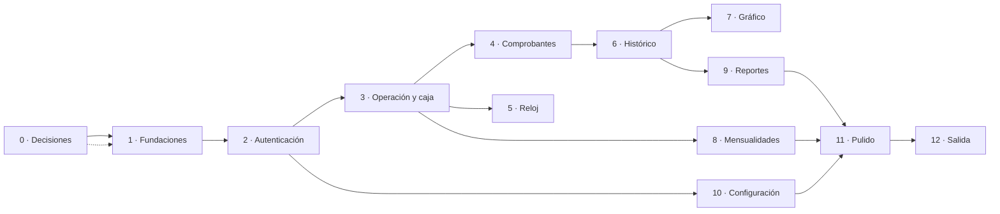

# 09 — Plan de implementación

## 9.1 Principios de orden

1. **Portar antes de Innovar.** Copiar el dominio verificado y adaptarlo es más
   seguro que reescribirlo. Sólo se reescribe la presentación.
2. **Escribir la prueba antes del endpoint.** El original tiene 92 pruebas
   unitarias y 41 de arnés que ya definieron el comportamiento correcto. Son la
   especificación ejecutable; no hay que reescribirlas, sólo portarlas.
3. **Un módulo abierto a la vez.** Abrir dos módulos de cobro simultáneos
   duplica el trabajo de integración y multiplica los errores de contrato.
4. **Nada de facturación electrónica.** En toda la duración del proyecto.
5. **Primero escritorio, después móvil.** El diseño responsive viene después de
   que la versión de escritorio funcione en un solo navegador de referencia.
6. **El módulo de reloj va pronto, no tarde.** Es el de mayor riesgo técnico. Dejarlo
   para el final significa descubrir tarde que hay que rediseñarlo.

## 9.2 Estimación total

| Sprint | Días | Contenido | Riesgo |
|---|---|---|---|
| 0 · Decisiones | 1–2 | Resolver §12, montar repositorio | Bajo |
| 1 · Fundaciones | 3–4 | Esquema, Alembic, API, esqueleto web | Bajo |
| 2 · Autenticación | 3–4 | Sesiones, roles, login, recuperación | Medio |
| 3 · Operación | 5–7 | Entrada, cotización, **cobro**, caja | **Alto** |
| 4 · Comprobantes | 4–5 | Emisión, vista previa, PDF, QR, reimpresión | Medio |
| 5 · Seguridad del reloj | 3–4 | Ancla del servidor, verificación, bloqueo | **Alto** |
| 6 · Histórico | 4–5 | Búsqueda, calendario, ocupación por hora | Medio |
| 7 · Gráfico y dashboard | 3–4 | Tarjetas, gráfico, detalle, clic al histórico | Medio |
| 8 · Mensualidades | 5–6 | Clientes, planes, saldos, **renovación** | Medio |
| 9 · Reportes | 3–4 | Consolidado, 5 exportaciones, XLSX | Bajo |
| 10 · Configuración | 3–4 | 6 pestañas, usuarios, tarifas, plantillas | Bajo |
| 11 · Pulido | 4–6 | Responsive, accesibilidad, rendimiento, PWA | Medio |
| 12 · Salida | 3–4 | Despliegue, migración de datos, capacitación | Medio |
| **Total** | **44–55** | | |

> **Supuestos de la estimación:** una persona desarrolladora con conocimiento
> previo del dominio. Con dos personas, 6–8 semanas. Si hay que reescribir la
> lógica en otro lenguaje, **multiplicar por 1,8** y descartar el beneficio de las
> pruebas portadas.

## 9.3 Sprint 0 · Decisiones (1–2 días)

**Ninguna línea de código.** Entregable: §12 de
[12-preguntas-abiertas.md](12-preguntas-abiertas.md) resuelto y firmado.

| Tarea | Responsable | Entregable |
|---|---|---|
| Motor de la base de datos | Equipo técnico | PostgreSQL o MySQL, decidido |
| Recuperación de administrador | Seguridad | Opción A, B o C |
| Formato de importes en el papel | Operación | Colombiano o inglés |
| Motor de plantillas del comprobante | Operación |-plantilla fija o variable |
| Necesidad de impresión térmica | Operación | Si hay impresora ESC/POS y cuál |
| Zona horaria por sede | Negocio | ¿Una zona o varias? |
| Alcance del MVP | Negocio | Los 10 módulos o un subconjunto |

**Criterio de salida:** el sprint 1 no empieza con ninguna decisión abierta.

## 9.4 Sprint 1 · Fundaciones (3–4 días)

| # | Tarea | Verificación |
|---|---|---|
| 1.1 | Repositorio: `backend/`, `frontend/`, `deploy/`, `docs/` | Los tres directorios existen |
| 1.2 | `alembic` con revisión `0001_initial` (25 tablas) | `upgrade head` y `downgrade base` funcionan |
| 1.3 | Revisión `0002_timestamps`: `TEXT` → `TIMESTAMPTZ` | Pruebas de ida y vuelta |
| 1.4 | Revisión `0003_constraints` (4 restricciones `CHECK`) | Las insertas inválidas fallan |
| 1.5 | `SEED_DATA` con `ON CONFLICT DO NOTHING` | Correrlo dos veces no falla |
| 1.6 | `db.py` con engine, sesión, `get_db` | — |
| 1.7 | `main.py` con `/api/health` | Responde 200 |
| 1.8 | `pydantic-settings` y `.env.example` | Arranca sin variables opcionales |
| 1.9 | Middleware de errores que traduce excepciones de dominio | Un `ValueError` del dominio da `400 validacion` |
| 1.10 | Vite + React + TS, `ThemeProvider`, `Shell`, rutas | La SPA arranca y navega |
| 1.11 | `api/client.ts` con manejo de `401` y `403` | — |

**Riesgo:** el middleware de errores. Si las excepciones del dominio no se
traducen de forma uniforme, cada endpoint
desarrollará su propio manejo y la
contratación se romperá. **Hacerlo primero y bien.**

## 9.5 Sprint 2 · Autenticación (3–4 días)

Orden dentro del sprint: dominio → dependencias → endpoints → frontend.

| # | Tarea | Verificación |
|---|---|---|
| 2.1 | Portar `authentication.py` | Los hashes existentes validan |
| 2.2 | `deps.py`: `get_current_user`, `require_role` | Matriz de rol §7.4 |
| 2.3 | `POST /api/auth/login` con cookie `HttpOnly` | El frontend no ve la cookie |
| 2.4 | `POST /api/auth/logout`, `GET /api/auth/me` | — |
| 2.5 | `POST /api/auth/password` | Revoca las otras sesiones |
| 2.6 | `AuthContext` y protecciones de ruta | `/reportes` redirige a `/login` |
| 2.7 | `LoginPage` con fondo y cristal | Modo claro y oscuro |
| 2.8 | `scripts/create_first_admin.py` | Crea el super admin |
| 2.9 | Prueba de matriz rol × endpoint | 3 roles × 22 endpoints |

**Riesgo:** que `_ROLE_IMPLICITS` se implemente como jerarquía. Es tentador
«simplificar» con «admin puede todo lo del operador». **No hacerlo**: ver §7.1.

## 9.6 Sprint 3 · Operación y caja (5–7 días) · **el más importante**

Se hace **antes** que todo lo demás porque maneja dinero. Si algo sale mal, que
sea pronto y con pocos datos encima.

| # | Tarea | Verificación |
|---|---|---|
| 3.1 | Portar `parking_operations.py` con `julianday()` sustituido | Los 7 esquemas de cobro dan los mismos importes |
| 3.2 | Portar `cash.py` | Un turno abierto por usuario y sede |
| 3.3 | `POST /api/stays` | Crea vehículo y factura en la primera visita |
| 3.4 | `GET /api/stays/{placa}/quote` | No cierra la estadía |
| 3.5 | `POST /api/checkout` | Transaccional de punta a punta |
| 3.6 | Idempotencia con `Idempotency-Key` | Repetir no cobra dos veces |
| 3.7 | `POST /api/payments/{id}/void` | Devuelve la estadía a `ACTIVE` |
| 3.8 | Endpoints de caja | Esperado del turno correcto |
| 3.9 | `OperationsPage`: flujo de tres pasos | Recorre el flujo completo |
| 3.10 | Campo de efectivo con **cambio en vivo** | Igual que `_update_change` |
| 3.11 | Selector de pago que muestra/oculta el efectivo | Igual que `_toggle_cash_fields` |

### Pruebas obligatorias del sprint

| Prueba | Por qué |
|---|---|
| Rollback: falla el recibo ⇒ no hay cobro | Nunca un comprobante sin cobro |
| Rollback: falla el cobro ⇒ la estadía sigue `ACTIVE` | Nunca una estadía cerrada sin cobro |
| Misma `Idempotency-Key` dos veces ⇒ un solo pago | Doble clic del operador no cobra dos veces |
| Efectivo insuficiente ⇒ `400` con el faltante | Mensaje útil en pantalla |
| `CARD` con `efectivo_recibido` ⇒ `400` | No se acepta efectivo en tarjeta |
| Cobro sin turno de caja abierto ⇒ `400` | La caja no se descuadra |
| Concurrencia: 20 cobros simultáneos de la misma placa | Un solo cobro gana; los demás reciben `409` |
| Numeración de recibos concurrente | Sin números duplicados |

> **Riesgo principal del sprint:** la **transacción**. El original usa
> `BEGIN IMMEDIATE` con `sqlite3`. En PostgreSQL el equivalente es `SELECT … FOR
> UPDATE` sobre la fila de la estadía, o el nivel de aislamiento `SERIALIZABLE`.
> Sin un bloqueo explícito, dos operadores cobrando la misma placa a la vez
> pueden generar dos pagos. **Esta prueba no es opcional.**

## 9.7 Sprint 4 · Comprobantes (4–5 días)

| # | Tarea | Verificación |
|---|---|---|
| 4.1 | Portar `receipts.py` | Sin cambios funcionales |
| 4.2 | `GET /api/receipts/{id}/preview` | Muestra exactamente lo que se imprime |
| 4.3 | PDF, PNG térmico 58/80 mm, barcode, QR | Los cuatro se descargan |
| 4.4 | `GET /r/{token}` público | Resuelve sólo con su token |
| 4.5 | `POST /api/receipts/{id}/reprint` | Incrementa contador y audita |
| 4.6 | Impresión del navegador con `@page` | El ancho del rollo se respeta |
| 4.7 | `ReceiptPreview.tsx` | Modal antes de imprimir |

## 9.8 Sprint 5 · Seguridad del reloj (3–4 días)

| # | Tarea | Verificación |
|---|---|---|
| 5.1 | Ancla del servidor en `clock_anchors` | Creada al arrancar |
| 5.2 | `verify_clock` con deriva | Detecta desviación |
| 5.3 | `check_before_billing` en cotización **y** cobro | Bloquea con `400` |
| 5.4 | Verificación externa con cabecera `Date` | **En hilo con espera máxima** |
| 5.5 | Reanclaje tras verificación correcta | Reactiva el cobro |
| 5.6 | `clock_checks` como evidencia | Cada verificación queda registrada |
| 5.7 | Botón «Verificar hora» en el dashboard | Equivale a `_verify_clock_online` |
| 5.8 | Prueba: red caída ⇒ el cobro **sigue** funcionando | — |

> **Los dos errores que hay que evitar:** (a) llamar a `today_for_site()` con una
> escritura en curso — bloquea y cuelga la operación 33 segundos; (b) poner la
> verificación externa en el hilo principal — la resolución de nombres no
> respeta el timeout de `urlopen` y congela la interfaz.

## 9.9 Sprint 6 · Histórico (4–5 días)

| # | Tarea | Verificación |
|---|---|---|
| 6.1 | Portar `history.py` con `julianday()` sustituido | Los filtros funcionan |
| 6.2 | `GET /api/history` con los 5 filtros | Combinados y sueltos |
| 6.3 | `occupancy_by_hour` y `occupancy_detail` | Mismo criterio temporal |
| 6.4 | `DatePicker` con los 4 formatos de entrada | Igual que `_leer` |
| 6.5 | `HistoryPage` con reimpresión de ambos comprobantes | — |

## 9.10 Sprint 7 · Gráfico y dashboard (3–4 días)

| # | Tarea | Verificación |
|---|---|---|
| 7.1 | `dashboard_summary` | Visible para admin y operador |
| 7.2 | `OccupancyChart.tsx` | 24 puntos, escala 1-2-3-5 |
| 7.3 | Línea de capacidad como referencia | — |
| 7.4 | Marca al pasar el ratón | — |
| 7.5 | Clic ⇒ detalle de esa hora | Coincide con el gráfico |
| 7.6 | Clic en el día ⇒ histórico con el rango puesto | `_open_history_for_day` |

## 9.11 Sprint 8 · Mensualidades (5–6 días)

| # | Tarea | Verificación |
|---|---|---|
| 8.1 | Portar `subscriptions.py` | Los 18 casos de la cartera pasan |
| 8.2 | `_month_end` con bisiesto | 31/01 + 1 mes = 28/02 |
| 8.3 | `_effective_status` derivado de la fecha | Un plan vencido sale `VENCIDA` |
| 8.4 | `renew_subscription` en **una** transacción | Si falla el cobro, no hay período nuevo |
| 8.5 | `_cash_movement` y `_open_shift` | Los 4 métodos de pago |
| 8.6 | `SubscriptionsPage` con listado y ficha | Los 7 estados |
| 8.7 | Los 5 diálogos | Alta, plan, cobro, renovación, cancelación |
| 8.8 | Alertas de cartera | Por vencer y vencida con saldo |

## 9.12 Sprints 9 y 10 · Reportes y configuración (6–8 días)

| Sprint | Tareas |
|---|---|
| 9 · Reportes | `reports.py`, `exporters.py`, 5 exportaciones, XLSX con 5 hojas y 2 gráficos, `ReportsPage` sólo para super admin |
| 10 · Configuración | `site_settings.py`, 6 pestañas condicionadas por rol, gestión de usuarios, tarifas versionadas, `SettingsPage` |

## 9.13 Sprint 11 · Pulido (4–6 días)

| Frente | Tareas |
|---|---|
| **Accesibilidad** | Contraste 4,5:1, foco visible, navegación por teclado completa, `aria-live` en cotización y cobro, objetivos de 44 px |
| **Responsive** | Los 5 puntos de §2.6 de [02](02-estructura-carpetas.md) |
| **Rendimiento** | Los 5 objetivos de §11 de [05](05-modulos-implementacion.md) |
| **Seguridad** | La lista de §7.8 de [07](07-autenticacion-autorizacion.md) |
| **PWA** | Instalable, con icono de la marca |
| **Impresión** | Verificar en la impresora real, si la hay |
| **Carga** | Estado de carga y vacío en todas las listas |

## 9.14 Sprint 12 · Salida (3–4 días)

| # | Tarea | Verificación |
|---|---|---|
| 12.1 | Despliegue en el servidor | Checklist §8.12 completo |
| 12.2 | Migración de datos | [10-migracion-y-convivencia.md](10-migracion-y-convivencia.md) |
| 12.3 | Prueba de restauración de la copia | **De verdad**, no en papel |
| 12.4 | Capacitación del operador | Un día |
| 12.5 | Período de convivencia | [10](10-migracion-y-convivencia.md) §10.3 |
| 12.6 | Retirada del escritorio | Sólo tras el período de convivencia |

## 9.15 Dependencias entre sprints

Ruta crítica: **0 → 1 → 2 → 3 → 6 → 7**. Los sprints 4, 5, 8, 9 y 10 tienen
holgura y pueden solaparse.

## 9.16 Qué hacer si el tiempo aprieta

**Conservar siempre:** autenticación, operación con cobro, caja, comprobantes,
mensualidades, el módulo de reloj.

**Se puede recortar:** el gráfico del dashboard (el dato sigue en el
histórico), el XLSX completo (quedan las 4 exportaciones restantes), el PWA, el
modo oscuro.

**No se puede recortar:** la transaccionalidad del cobro, la idempotencia, el
bloqueo por reloj, la matriz de permisos y la auditoría.

## 9.17 Señales de que algo va mal

| Señal | Causa probable | Acción |
|---|---|---|
| La paridad cae por debajo del 90 % en [01](01-matriz-paridad-funcional.md) | El alcance creció a mitad del proyecto | Volver a [01](01-matriz-paridad-funcional.md) y decidir qué sale |
| La transacción del cobro da errores de bloqueo | Falta `SELECT … FOR UPDATE` | Volver a §9.6 |
| El gráfico y el detalle no coinciden | Se divergieron los criterios temporales | Unificar en `history.py`, no en el frontend |
| Un operador ve un `403` inesperado | Se implementó la jerarquía de roles por error | Revisar `_ROLE_IMPLICITS` |
| Las pruebas portadas fallan | Se cambió un comportamiento en el camino | **El código es el que se equivoca**, no la prueba |